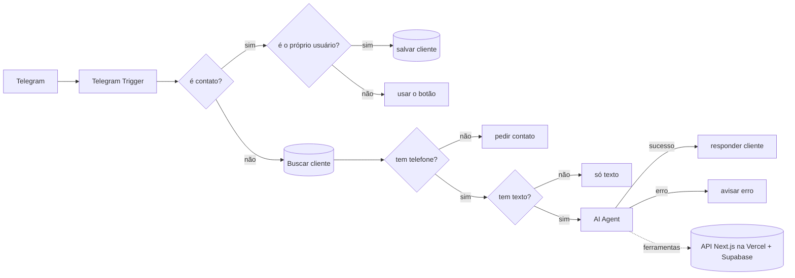

# Siconeli Barber — agente de agendamento no Telegram

Bot do Telegram que **agenda, cancela e remarca** horários de barbearia em linguagem natural, feito em **n8n** com um agente de IA que usa a API real de um sistema de agendamentos (Next.js + Supabase).

> **Projeto de demonstração, sem clientes.** A barbearia é fictícia e todos os agendamentos são de teste.

<!-- Coloque aqui o GIF da conversa: docs/demo.gif -->

## O que ele faz

```
Cliente: marca uma barba amanhã de manhã
Bot:     Para sexta-feira, 06/11, tenho estes horários de barba:
         Manhã: 09:00, 09:30, 10:00, 10:30, 11:00, 11:30
         Qual prefere?
Cliente: 9
Bot:     Barba na sexta-feira, 06/11, às 09:00, por R$ 35. Posso confirmar?
Cliente: sim
Bot:     Agendado! Você pode conferir em https://siconeli-barbearia.vercel.app/meus-agendamentos
```

- Entende datas relativas ("amanhã", "terça", "dia 20"), erros de digitação e pedidos ambíguos ("cancela o de segunda" quando há dois).
- **Sempre pede confirmação** antes de criar ou cancelar.
- **Remarca na ordem segura**: cria o novo horário primeiro e só depois cancela o antigo. O cliente nunca fica sem horário.
- Recusa assuntos fora da barbearia e tentativas de mudar o preço.
- O agendamento aparece na hora no site, marcado como `origem: telegram`.

## Arquitetura



| Camada | Tecnologia |
|---|---|
| Canal | Telegram Bot API |
| Orquestração | n8n self-hosted em Docker (Oracle Cloud Free Tier) |
| Modelo principal | `qwen-3.8-27b` no Cerebras |
| Modelo reserva | `gpt-oss-120b` no Groq |
| Memória | Simple Memory do n8n (janela de 4 mensagens por chat) |
| Cadastro do cliente | Data table do n8n (`chat_id`, `telefone`, `nome`) |
| Agenda | API do sistema de agendamentos (Next.js na Vercel + Supabase) |

### Ferramentas do agente

| Ferramenta | Chamada | O que o modelo preenche |
|---|---|---|
| `listar_horarios_livres` | `GET /api/horarios?formato=compacto` | data e serviço |
| `criar_agendamento` | `POST /api/reservar?formato=compacto` (header `x-agent-key`) | data, hora e serviço |
| `listar_meus_agendamentos` | `GET /api/meus-agendamentos?formato=compacto&telefone=…` | nada |
| `cancelar_agendamento` | `POST /api/cancelar` | id do agendamento |

**Nome e telefone nunca passam pelo modelo.** Eles vêm do cadastro feito com o botão "Compartilhar meu contato". Por isso, o modelo não tem como consultar nem cancelar agendamentos de outra pessoa.

## Decisões técnicas

1. **Quem decide a disponibilidade é o banco, não o LLM.** O modelo só repete os horários que a API devolveu naquela mensagem. Se alguém ocupar o horário pelo site durante a confirmação, a API responde 409 e o bot oferece as alternativas atualizadas (testado).
2. **Identidade pelo contato do Telegram.** O cliente compartilha o próprio número uma vez, e o fluxo confere `contact.user_id == from.id`, para impedir o envio do contato de outra pessoa.
3. **Calendário calculado em código e injetado no prompt.** O modelo errava a aritmética de datas: chegou a converter "terça" para uma segunda-feira. O prompt agora recebe uma tabela de 31 dias (a janela de agendamento) e a regra de nunca calcular datas.
4. **Formato compacto nas APIs.** Criei o parâmetro `?formato=compacto` nos quatro endpoints usados pelo agente. As respostas completas tinham cerca de 3 KB de campos que o modelo não usa, que gastavam tokens e confundiam o modelo. Os tokens por mensagem caíram de ~8,9k para ~3,4k.
5. **Mensagens de erro da API viram prompt.** Quando a API usava a mesma mensagem para "já cancelado" e "fora do prazo de 2h", o modelo inventava o motivo. Mensagens distintas resolveram.
6. **Mensagens sem texto barradas no fluxo, não no LLM.** Figurinhas e áudios caem num IF antes do agente: custo zero de tokens e nenhuma chance de erro.
7. **Principal e reserva em provedores diferentes.** No plano gratuito, cada provedor limita os tokens por minuto, e uma ação de agendamento faz 3 chamadas ao modelo. Com principal e reserva no mesmo provedor, as duas cotas acabavam juntas.
8. **Escolha do modelo com dados de produção.** O `gpt-oss-120b` às vezes vazava o raciocínio interno na resposta final ("Agendamento ag…", "Oops…"). Investiguei a hipótese de corte por limite de tokens e os dados a descartaram (`finish_reason: stop`, 39 tokens). Depois de trocar de provedor, os limites da conta (5 req/min para o gpt-oss contra 450 para o Qwen) decidiram o modelo principal.

## Evolução do workflow

A pasta [`workflow/historico/`](workflow/historico/) guarda três exportações com data, que mostram o projeto crescendo:

| Versão | O que tinha |
|---|---|
| `2026-10-30.json` | Só agendar: cadastro pelo contato, `listar_horarios_livres` e `criar_agendamento` no Groq, calendário de 14 dias |
| `2026-11-05.json` | Cancelar e remarcar, regex contra o vazamento do gpt-oss, `tem texto?`, regras de escopo e de "hoje/amanhã" |
| Atual: [`workflow/barber-agent-telegram.json`](workflow/barber-agent-telegram.json) | Cerebras + Qwen como principal, Groq como reserva, calendário de 31 dias, regra de confirmação prioritária, respostas compactas |

## Testes

37 conversas documentadas, com o esperado, o resultado e a correção de cada falha: **[docs/testes.md](docs/testes.md)**.

Os casos incluem condição de corrida com o site, datas fora da janela, domingo fechado, horário que já passou, ambiguidade, remarcar para um horário ocupado, contato de outra pessoa, manipulação de preço, perguntas fora do assunto, figurinhas e mensagens enviadas em sequência rápida.

## Limitações conhecidas

- **No site, o telefone é a única identificação do cliente.** O bot verifica o número pelo contato do Telegram, mas a API do sistema de agendamentos não verifica: `GET /api/meus-agendamentos?telefone=…` lista os agendamentos de qualquer número informado, e `POST /api/cancelar` cancela com o id e o mesmo telefone. Ou seja, quem souber o número de alguém consegue ver e cancelar os horários dessa pessoa pelo site. Isso vem do desenho original do sistema, que dispensa login, e é aceitável numa demonstração. Em produção, o certo seria confirmar o número com um código enviado por SMS ou WhatsApp antes de mostrar os agendamentos.
- **A confirmação é garantida pelo prompt, não pelo código.** Num teste, o modelo criou um horário no remarcar antes de pedir confirmação. Corrigi com uma regra prioritária, mas um LLM pode voltar a falhar. A solução robusta está nas melhorias futuras.
- **Planos gratuitos.** O Cerebras roda com créditos gratuitos e limite de gasto. O Groq, usado como reserva, tem limite de tokens por minuto. Em uso real, seria preciso um plano pago.
- **A mensagem de erro não reflete o estado real.** Se a resposta falhar depois de uma ação já concluída, o bot diz "Estou com uma instabilidade" mesmo com o agendamento feito, e o cliente pode tentar de novo e duplicar.
- **Memória curta.** A janela de 4 mensagens economiza tokens, mas o bot esquece o contexto mais antigo. Num teste, a memória também fez o bot retomar um pedido antigo depois de um simples "oi".
- **Só texto e só português.** Áudio, imagem e outros idiomas não são tratados.
- **Um barbeiro.** A demonstração usa um único profissional. A API aceita vários, mas o agente não pergunta a preferência.

## Melhorias futuras

- **Confirmação garantida no fluxo:** guardar a ação pendente numa data table e só executá-la quando a mensagem seguinte for uma confirmação.
- Mensagem de erro que manda o cliente conferir em "Meus agendamentos" antes de tentar de novo.
- Regra para o bot nunca retomar pedidos antigos da memória sem o cliente pedir.
- Link de conferência adicionado pelo fluxo, e não pelo modelo, sempre que houver um agendamento criado.
- Lembrete automático 2 horas antes do horário.
- Transcrição de áudio (Whisper) para aceitar mensagens de voz.
- Testes automatizados com o Evaluations do n8n, usando a tabela de testes como conjunto de dados.

## Como rodar

1. Importe `workflow/barber-agent-telegram.json` no n8n (**⋯ → Import from File**).
2. Crie as credenciais (nenhuma chave vem no arquivo):
   - **Telegram**: token do bot criado no @BotFather;
   - **OpenAI** (usada para o Cerebras): API key do Cerebras, com Base URL `https://api.cerebras.ai/v1`;
   - **Groq**: API key do Groq;
   - **Header Auth** para o `criar_agendamento`: header `x-agent-key` com o valor de `AGENT_API_KEY` do sistema de agendamentos.
3. Crie a data table `clientes_telegram`, com as colunas `chat_id`, `telefone` e `nome`.
4. Troque as URLs `https://siconeli-barbearia.vercel.app/...` das ferramentas pelo endereço do seu sistema de agendamentos.
5. Publique o workflow e mande "oi" para o bot.

## Segurança

- Nenhuma chave ou token está no repositório: as credenciais ficam no n8n, e o JSON exportado só tem as referências.
- O agente só consulta e cancela agendamentos do telefone verificado pelo Telegram. O site não tem essa verificação (veja as limitações).
- O preço e a disponibilidade são validados no servidor e não podem ser alterados pela conversa.
- Todos os dados de teste são fictícios.
